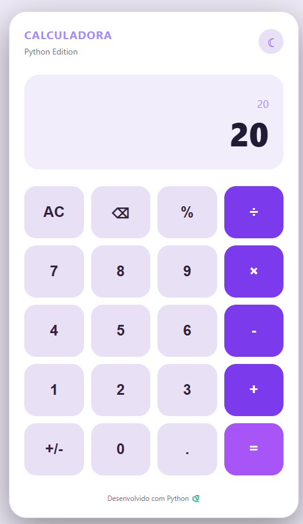
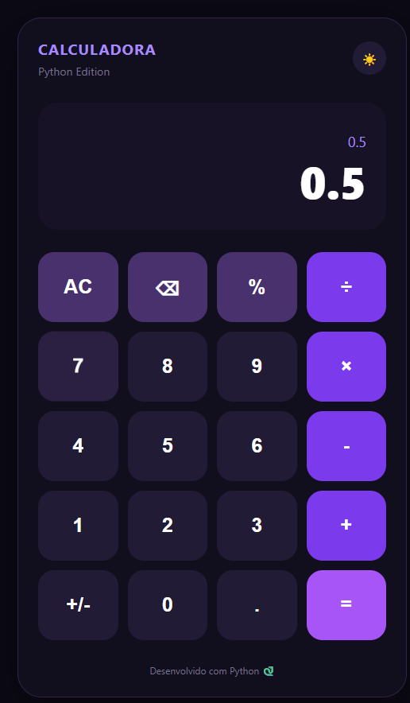

# 🧮 Calculadora Python

Aplicação web de calculadora desenvolvida com Python e Flask, com interface moderna, responsiva e alternância entre temas claro e escuro.

O projeto foi desenvolvido para praticar programação Python, desenvolvimento web e integração entre frontend e backend.

## 🖥️ Demonstração

### ☀️ Tema Claro



### 🌙 Tema Escuro



## ✨ Funcionalidades

- Adição, subtração, multiplicação e divisão.
- Cálculos de porcentagem.
- Tratamento de divisão por zero.
- Operações pelo mouse ou teclado do computador.
- Alternância entre tema claro e escuro.
- Interface responsiva.
- Processamento das operações matemáticas em Python.

## 🛠️ Tecnologias utilizadas

- Python
- Flask
- HTML5
- CSS3
- JavaScript

## 📂 Estrutura do projeto

```text
calculadora-python/
│
├── assets/
│   └── icons/
│
├── img/
│   ├── modo-claro.png
│   └── modo-escuro.png
│
├── static/
│   ├── css/
│   │   └── style.css
│   │
│   └── js/
│       └── calculadora.js
│
├── templates/
│   └── index.html
│
├── app.py
├── requirements.txt
└── README.md
```

## ⚙️ Como executar o projeto

### 1. Clone o repositório

```bash
git clone URL_DO_REPOSITORIO
```

### 2. Acesse a pasta

```bash
cd calculadora-python
```

### 3. Instale as dependências

```bash
pip install -r requirements.txt
```

### 4. Execute a aplicação

```bash
python app.py
```

### 5. Acesse no navegador

```text
http://127.0.0.1:5000
```

## 📚 Aprendizados

Durante o desenvolvimento, foram praticados:

- Criação de aplicações web com Flask.
- Desenvolvimento de rotas.
- Processamento de formulários.
- Manipulação de expressões matemáticas com Python.
- Tratamento de exceções.
- Integração entre frontend e backend.
- Manipulação do DOM com JavaScript.
- Organização de projetos.

---

Desenvolvido com Python 🐍